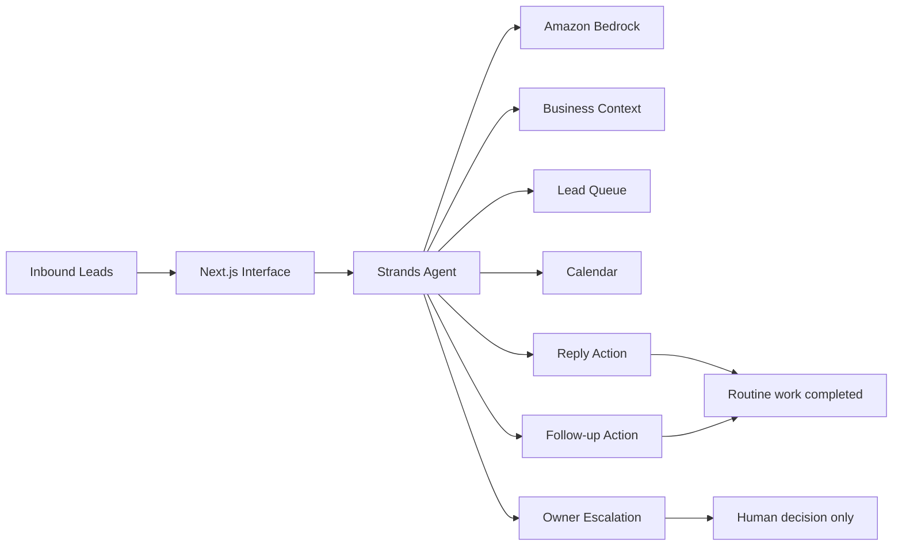

# Lead Rescue

**Experimental lead-intake and follow-up prototype for small service businesses, built with the Strands Agents SDK. Not a live customer service.**

The hackathon prototype explores the work between “new inquiry” and “owner decision.” Its code includes lead-queue, business-policy, calendar-check, reply and follow-up tools. These are prototype capabilities, **not evidence of a connected customer inbox, production calendar, or customer messages actually delivered**. The proposed commercial pilot is narrower: intake triage and **draft follow-ups requiring owner approval before sending**.

## Live fictional sales preview

**[Open the working $99 inquiry-review preview](https://lead-rescue-pilot.vercel.app)** — five fictional service-business inquiries, an editable owner-review queue, safe draft replies, and a downloadable example CSV. The demonstration contains no real customer data, never sends messages, and does not accept payments. Production integrations are not claimed.

## Paid inquiry follow-up review

A single-business, fixed-price **$99 inquiry follow-up review** is open for opt-in interest. It maps one inbound workflow, uses only fictional or fully redacted examples, produces an owner-reviewed queue plus five editable reply drafts, and includes an opt-out handoff checklist. This is not call answering or missed-call automation: it includes no phone-number provisioning, trigger setup, CRM migration, technical implementation, automatic sending, customer identifiers, credentials, payment data, production-system access, bookings, discounts, or safety decisions.

[Review the pilot scope and opt in on issue #5](https://github.com/jpadilla987-png/lead-rescue-agent/issues/5).

Built during the **Agents for Humans Hackathon 2026** for the **Professional Agents** track.

## The problem

Small service businesses lose good leads because the owner is simultaneously doing the work, answering calls, driving, quoting jobs, and managing a calendar. Typical lead software creates another inbox to manage. Lead Rescue is designed to do the opposite: quietly clear routine work and surface only decisions that genuinely need the owner.

## What the sample demo illustrates

The sample queue contains three intentionally different leads:

1. **Urgent no-cooling request** — the agent identifies urgency, uses the configured demo availability source, and may propose a same-day slot within that sample.
2. **Price-match negotiation** — the agent is not allowed to invent a discount, so it escalates a concise decision to the owner.
3. **Routine tune-up** — the agent checks the configured calendar source and illustrates a reply and follow-up workflow.

The code contains state-changing workflow tools. In the sample environment, these actions must **not** be interpreted as verified external deliveries, booked appointments, or production integrations. Do not run with real customer data or enable customer sending without explicit authorization, consent, safeguards and integration tests.

## Architecture



A larger version is in [`docs/architecture.md`](docs/architecture.md).

## Strands implementation

The core agent lives in [`lib/agent.ts`](lib/agent.ts). It uses the Strands tool system for:

- `get_business_context`
- `get_new_leads`
- `check_availability`
- `send_customer_reply`
- `schedule_follow_up`
- `escalate_to_owner`
- `mark_lead_closed`

The preferred hackathon model path is **Amazon Bedrock**. A Vercel AI Gateway model path is included as a convenience for a live hosted demo when Bedrock credentials are not present.

## Run locally

Requirements: Node.js 20+ and an AWS account with Bedrock model access.

```bash
npm install
cp .env.example .env.local
# configure AWS credentials using your preferred AWS-supported method
npm run dev
```

Open `http://localhost:3000` and press **Run the lead queue**.

### Amazon Bedrock configuration

The app automatically uses Bedrock when AWS credentials are present. The default model ID is:

```text
global.anthropic.claude-sonnet-4-6
```

Override it with `BEDROCK_MODEL_ID` if your AWS account uses a different enabled Bedrock model.

### Optional Vercel live-demo fallback

If AWS credentials are absent, the app uses the Vercel AI Gateway adapter supported by Strands. On a Vercel project with AI Gateway enabled, OIDC can provide authentication without storing a provider API key.

## Commercial pilot boundaries and safety

The proposed Lead Rescue pilot is **not launched**. It requires customer consent and an approved data-processing arrangement, validated opt-out handling, secure storage and deletion rules, verified calendar/inbox integration, human approval of outbound messages, and an audit trail before any real customer data or sending. Never claim that this repository alone provides those operational safeguards.

## Safety / human-in-the-loop design

Lead Rescue is intentionally conservative around irreversible or owner-only decisions. The prompt and tool boundary prohibit the agent from independently making discounts, price matches, unusual warranty commitments, or unsupported promises. Those cases are converted into explicit owner decisions with options.

## Why this can become a business

The same architecture can be adapted to garage-door companies, roofers, landscapers, HVAC contractors, electricians, junk-removal companies, and other local businesses where missed or slow lead response directly costs revenue.

The commercial product is not “AI chat.” The outcome is **faster lead response, fewer forgotten follow-ups, and fewer owner interruptions.**

## Hackathon disclosure

This project was newly created during the 2026 Agents for Humans Hackathon submission period. AI coding assistance was used during development. No pre-existing application code was incorporated.

## License

MIT
